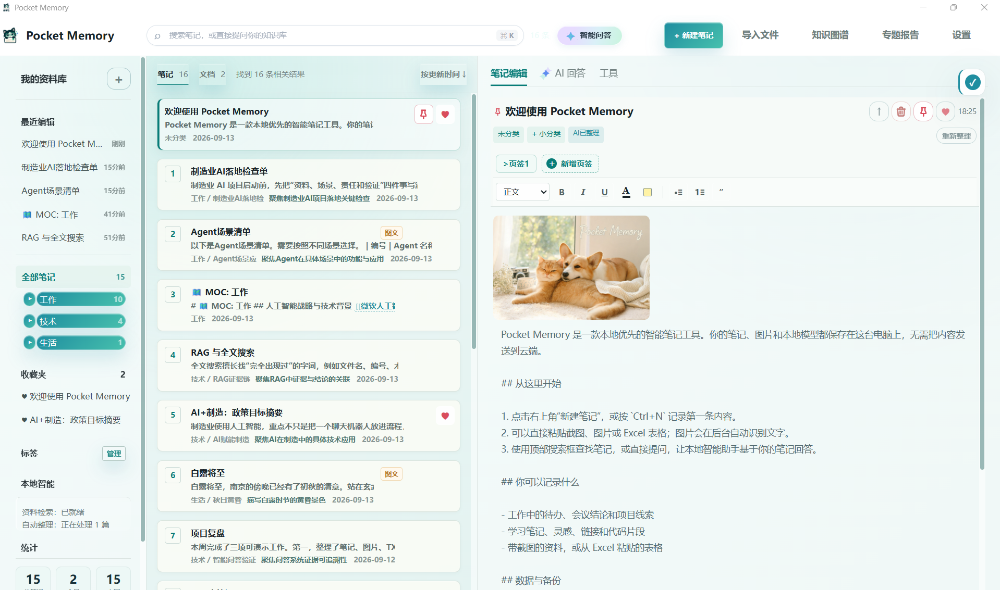
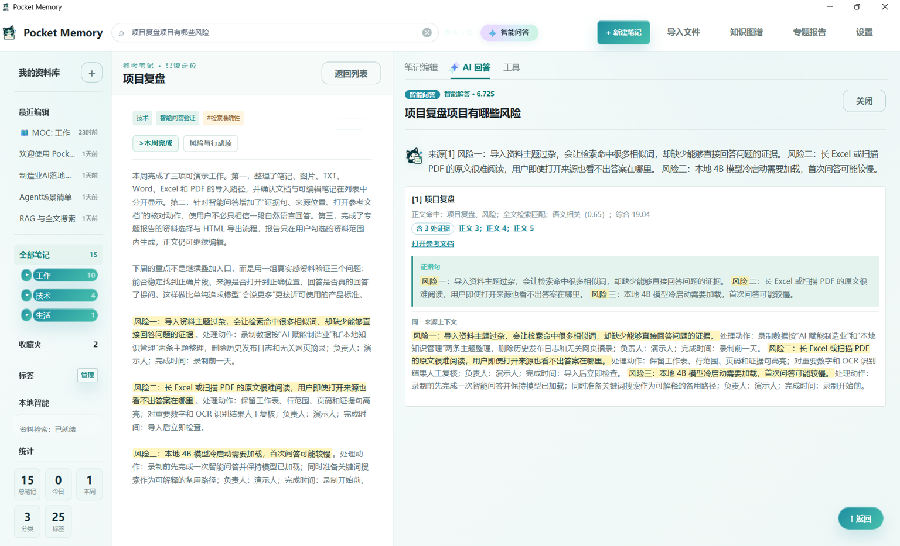

# Pocket Memory

Pocket Memory is a Windows-first, local knowledge workspace for notes and files. It helps you record material, import documents, retrieve evidence, ask questions against local sources, and return to the original location for review.

## Product tour

### [Open the live product tour ->](https://ashleysama.github.io/pocket-memory-agent/)

<p align="center">
  
</p>

<p align="center"><i>One workspace for notes, files, editing, and source-grounded answers.</i></p>

<p align="center">
  
</p>

<p align="center"><i>Answers are paired with evidence, source information, and a path back to the original material.</i></p>

> **1.2.0-beta.1 — Beta software.** This repository is for evaluation and community collaboration. It is not a guarantee of factual correctness, a substitute for source review, or a security-certified enterprise product.

## What it does

- Multi-tab rich-text notes with tables, images, history, pinning, favorites, folders, tags, backlinks, and a local relation graph. Notes open in reading mode; choose Edit/Done to edit, with visible saving, saved, and failed-save states.
- Import TXT, DOCX, XLSX, PDF, and images. Content is parsed into locatable chunks such as paragraphs, pages, worksheets, and row ranges.
- Search across local material; the default retained Q&A backend combines BGE vectors and BM25 through LlamaIndex, then uses local FlashRank reranking and source-aware evidence assembly.
- Local evidence-grounded Q&A that shows a concise answer, source, evidence sentence, and an entry point back to the original note or document.
- OCR for local images, original-file replacement and re-indexing, full backup, data-directory switching, and editable HTML topic-report drafts.

## Local-first design

- Notes, attachments, SQLite metadata, indexes, and configured models are stored in local directories.
- The application binds its unauthenticated HTTP service to loopback addresses only.
- The default Q&A path uses a local GGUF model. No cloud LLM API key is required.

This is not an absolute security guarantee. Do not use an unreviewed Beta build as the sole control for sensitive, regulated, or high-risk decisions. Always verify important numbers, dates, authorization rules, quality, and safety information in the original source.

## Quick start: source checkout

### Prerequisites

- Windows 10/11
- Python 3.11 or later
- Microsoft Edge WebView2 Runtime recommended for the desktop window
- Optional local model files for semantic search, OCR, automatic organization, and Q&A

```powershell
git clone https://github.com/AshleySama/pocket-memory-agent.git
cd pocket-memory-agent
.\setup_venv.bat
.\run_dev.bat
```

`setup_venv.bat` installs the complete `requirements.txt` dependency set, including `requirements-rag.txt`, and checks imports. Install the assets in [Model setup](docs/MODELS.md) before using retained Q&A; Python dependencies alone do not include model weights. This Beta keeps the existing Qwen3-4B-Instruct-2507 Q4_K_M model configuration.

For an isolated local data directory during development:

```powershell
.\.venv\Scripts\python.exe app.py --data-dir .\dev-data --no-browser
```

The repository deliberately does **not** contain model weights, user notes, databases, release archives, or test outputs. See [Model setup and licenses](docs/MODELS.md) before adding models.

## Trying the Windows Beta package

Extract the Beta into a new folder and use `Start-Beta.bat`. It sets `LOCALAPPDATA` to the package's `beta-profile` folder and passes `--data-dir` for `data-beta`, keeping Beta configuration and data separate from the previous stable installation. Use `Stop-Beta.bat` to stop the Beta background process; closing the window may leave it running. Directly opening `PocketMemory.exe` can reuse the Windows user's existing configuration.

Keep the old stable folder and original library. To test existing content, use a complete backup restored into a separate copy; do not point the Beta at the original library. See [Windows operation](docs/INSTALL_WINDOWS.md). Packaged local-model Q&A, OCR, document parsing, child-tab writes and backup/restore were exercised. The strict historical quality smoke remains failed: a correct table answer includes an adjacent row in displayed evidence; a correct missing-field refusal cites the inspected table rather than returning zero sources. No RAG code was changed to make these checks pass. Target-machine and business acceptance remain pending.

## Typical workflow

1. Create a note or import files.
2. Review the extracted document chunks when the material is complex.
3. Search by title, keyword, or a natural-language question.
4. For important answers, open the cited source and verify the highlighted evidence in context.
5. Select relevant materials to generate an editable HTML topic report when you need a structured output.

## Quality and limitations

Pocket Memory uses retrieval-augmented generation (RAG), not a guaranteed fact database. Retrieval can miss relevant material or select a superficially similar passage. OCR and complex spreadsheet/PDF parsing can also be imperfect. The public fixtures are synthetic regression materials; they are **not** evidence that the product has passed a real-user acceptance benchmark.

Read [RAG limitations and evaluation](docs/RAG_LIMITATIONS_AND_EVALUATION.md) before relying on Q&A results.

## Development

Install development dependencies with `python -m pip install -r requirements-dev.txt`. Run the Python suite and frontend checks (the latter require Node.js):

```powershell
$env:PYTHONDONTWRITEBYTECODE='1'
python -m unittest discover -s tests -q
node tests/frontend/test_reference_highlights.cjs
node tests/frontend/test_answer_display.cjs
node tests/frontend/test_clarification_display.cjs
node tests/frontend/test_editor_workflow.cjs
```

The 2026-10-29 source candidate has passing results for 567 distinct Python tests and 36 frontend checks. One stale test expectation for the displayed note-tab label was corrected and rechecked. These engineering checks do not measure answer factual accuracy. Packaged local-model Q&A, OCR, document parsing, child-tab writes and backup/restore were exercised. The strict historical quality smoke remains failed: a correct table answer includes an adjacent row in displayed evidence; a correct missing-field refusal cites the inspected table rather than returning zero sources. No RAG code was changed to make these checks pass. Target-machine and business acceptance remain pending.

## Documentation

- [Windows installation and local operation](docs/INSTALL_WINDOWS.md)
- [Architecture](docs/ARCHITECTURE.md)
- [Model setup and third-party model boundaries](docs/MODELS.md)
- [Privacy and data boundaries](docs/PRIVACY.md)
- [RAG limitations and evaluation](docs/RAG_LIMITATIONS_AND_EVALUATION.md)
- [Third-party notices](THIRD_PARTY_NOTICES.md)
- [Contributing](CONTRIBUTING.md)
- [Security reporting](SECURITY.md)

## License

Pocket Memory source code is licensed under [Apache-2.0](LICENSE). Model weights, OCR assets, example data, fonts, and third-party packages are governed by their own licenses. See [THIRD_PARTY_NOTICES.md](THIRD_PARTY_NOTICES.md).

### License and attribution

If you redistribute this project or create a derivative work, retain the [LICENSE](LICENSE) and [NOTICE](NOTICE) files and preserve the original-project attribution:

    Original project: Pocket Memory
    Original author: AshleySama
    https://github.com/AshleySama/pocket-memory-agent
    Licensed under Apache-2.0

You may add your own copyright notice for your original changes, but do not remove the original notice from files or distributions that include Pocket Memory code.

## Community feedback

Please use GitHub Issues for reproducible defects and feature proposals. Do not attach private notes, credentials, customer data, screenshots containing sensitive information, or model files to public issues.
